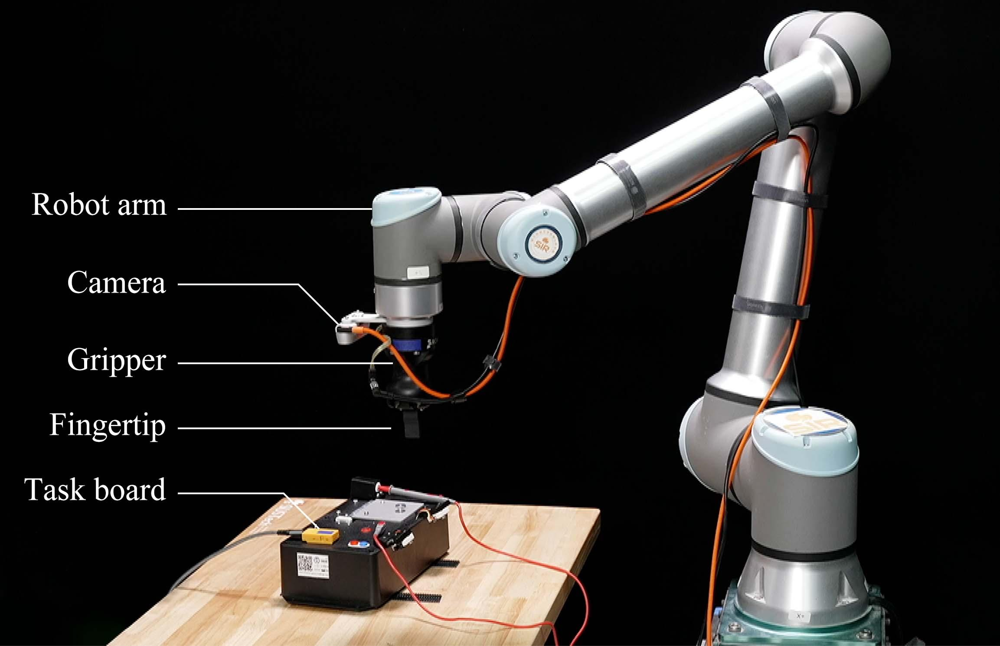
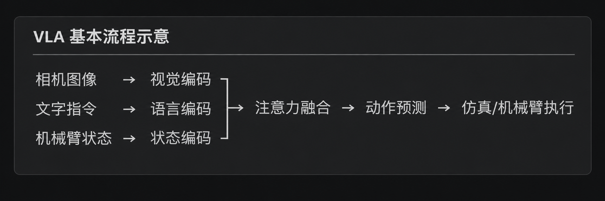

# 第 00 章 · VLA 是什么？

桌上有一个红杯和两个盘子。你对机械臂说「把红杯放到左边的盘子上」，它得根据相机画面找到杯子和盘子，再控制夹爪拿起杯子、移过去、放下。如果把「左边」换成「右边」，放置的目标也应随之改变。这就是本教程要做的任务。

## 1. VLA 的输入和输出

VLA是 **Vision-Language-Action（视觉—语言—动作）** 的缩写。

简而言之，最基本的VLA，就是把**视觉信息**（机械臂上的相机的视频帧，每一帧是一张图片，以一定频率输入到模型中）和**语言信息**（用户的任务指令）输入到整个模型“黑箱”中，然后输出符合视觉和指令的动作，输出动作的形式往往是n维向量，n就是机械臂的自由度（具体动作表示相关会在chapter02细讲）。

| 数据 | 红杯任务里的例子 |
| --- | --- |
| 视觉Vision | 相机拍到桌面、红杯和两个盘子。 |
| 语言Language | 指令指定的物体和任务，例如「把红杯放到左边的盘子上」。 |
| 机器人状态State/Proprioception | 机械臂末端当前的位置和姿态，夹爪的张开程度等。 |
| 动作Action | 一组控制量，例如让末端移动、转动，或让夹爪合拢。 |

关于这些输入和闭环执行，可以参阅 [TorchRL 的 VLA 入门教程](https://docs.pytorch.org/rl/main/tutorials/vla.html)。

## 2. 常见的动作生成路线

VLA 有很多种做法。入门可以先看一个具体问题：**模型最后怎样给出动作？**

| 路线 | 怎么生成动作 | 代表模型 |
| --- | --- | --- |
| **直接预测数值（Regression）** | 模型直接给出移动量、转动量和夹爪控制值等数字。可以一次预测一步，也可以一次预测接下来的几步。 | [ACT](https://arxiv.org/html/2304.13705) |
| **预测动作编号（tokenization）** | 先把连续数值划分成若干档，每档用一个编号表示（token）。模型预测离散编号，程序再把编号转回可执行的数值。 | [RT-1](https://arxiv.org/html/2212.06817)、[RT-2](https://robotics-transformer2.github.io/)、[OpenVLA](https://openvla.github.io/) |
| **逐步生成动作（Diffusion/Flow matching）** | 可以从随机数（噪声）开始，根据画面和指令逐步调整，通过多次迭代生成连续动作。扩散和流匹配是这类生成路线中常见的两种方法。 | [π₀](https://arxiv.org/html/2410.24164)（Flow Matching） |

图像和文字怎样输入到模型（对齐/融合）是另一个设计选择。例如，本教程用注意力融合图像与文字，再直接预测动作数值。 **动作块（chunk）** 则指一次预测连续几步动作，这三种路线都可以用来预测动作块。[TorchRL 的动作头介绍](https://docs.pytorch.org/rl/main/tutorials/vla.html#vlas-in-a-nutshell)

## 3. 三种路线的优缺点

| 路线 | 优点 | 缺点 |
| --- | --- | --- |
| **Regression** | 容易实现，一次就能输出连续动作。 | 如果同一场景下有多种合理动作，简单回归可能把它们平均，得到一个不合适的动作。 |
| **Tokenization** | 可沿用语言模型预测token的做法。 | 连续量量化为离散的，会损失精度，而且预测的是离散token，输出的动作可能有“卡顿”，连续性不足 |
| **Diffusion/Flow matching** | 能表示同一场景下多种合理的连续动作。 | 通常要经过多轮计算，推理开销较高。 |

## 4. 本教程会搭建什么

我们用 LIBERO 的仿真场景和官方演示，从红杯放到左盘开始，再加入放到右盘的指令和演示。每种输入先各自编码成一组特征，再通过注意力让这些特征交换信息。动作头根据融合后的特征，直接预测连续动作。

训练时，模型根据某一时刻的画面、指令和状态预测动作，程序将它与演示里同一时刻的动作比较，再用误差更新模型。这种从演示中学习的方法叫**行为克隆**。学完之后，我们会在仿真中测试机械臂能否把杯子放到指定盘子，也会在匹配的初始场景中切换左右指令，观察放置目标是否随之改变。[LIBERO 官方演示数据](https://libero-project.github.io/datasets)

下一章会打开杯子场景，先看相机和机械臂能给模型提供哪些信息。[第 01 章 · 仿真环境](../01_environment/仿真环境与演示数据.md)
