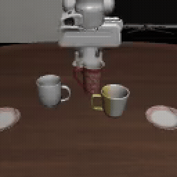
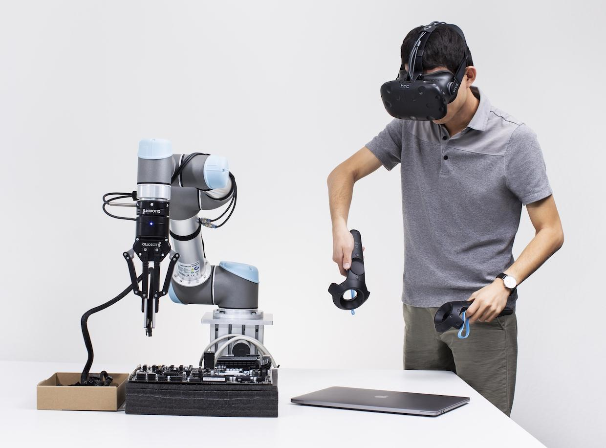
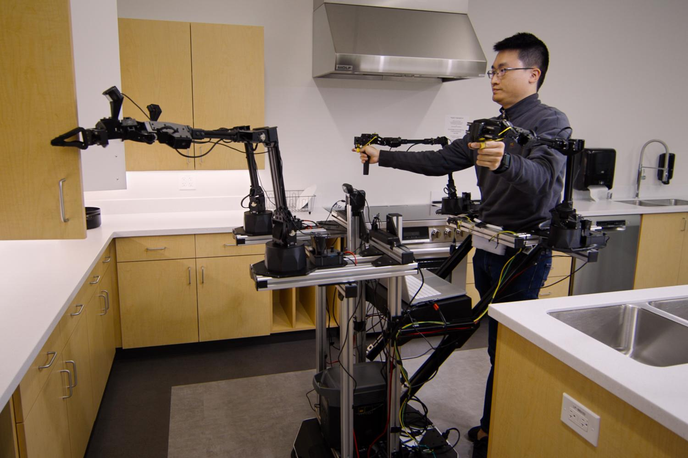
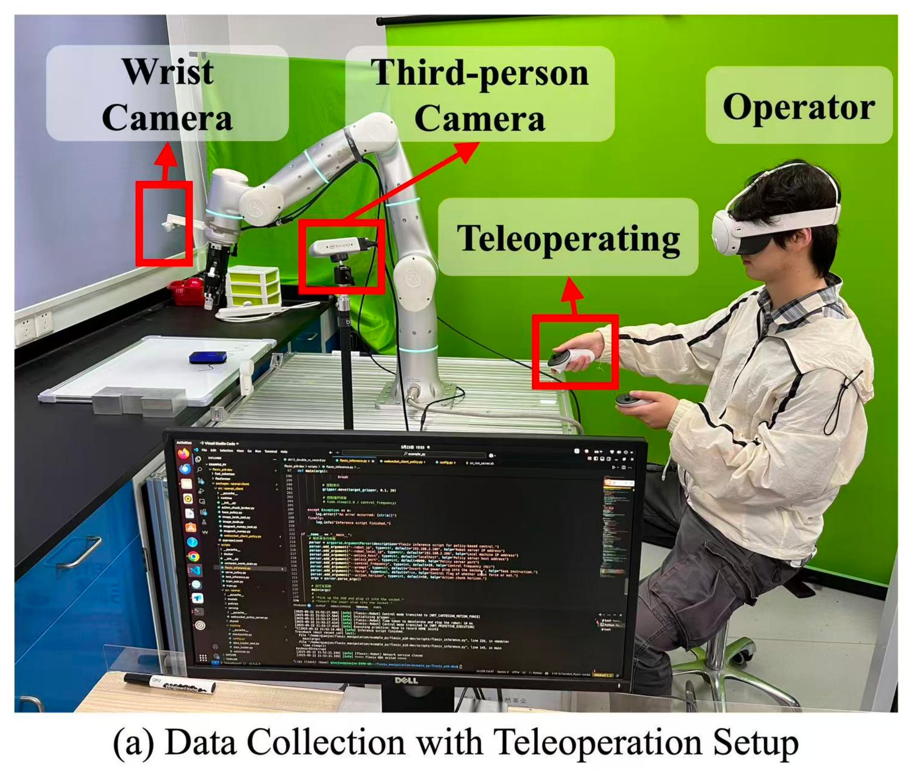

# 第 01 章 · 仿真环境与演示数据

训练一个能听懂人话、看懂画面并动手干活的VLA机器人模型，如果一上来就在真实世界里拿真机机械臂试错，不仅硬件成本高，机械臂一旦算错动作还可能撞坏桌子甚至伤到人。因此，在把模型部署到真机之前，研究人员几乎都会先在虚拟的仿真世界里完成训练和评测。

上图是「红杯放左盘」的仿真执行示例，来自 Luo 和 Du 的模型在 LIBERO 中的一次运行。[项目演示页](https://video-to-action.github.io/#lb_qual_tk65) · [MP4 视频](media/libero90-red-mug-left.mp4)

## 1. 物理引擎、任务环境和数据集有什么区别？

你一定会好奇上面的gif和视频是怎么做出来的，在这样一个仿真环境，夹爪与杯壁的接触是怎么判定的？肯定不像我们肉眼去看到二者紧贴就算是抓紧了，要想精确判断，肯定少不了各种物理参数：摩擦力、中立、弹力等等。以及这个抓杯子的任务是怎么被定义的，机械臂在仿真环境里又是怎么控制的。这就引出仿真中最关键的：物理引擎、任务环境和数据集。

| 概念 | 负责什么 | 在红杯任务里的例子 |
| --- | --- | --- |
| **物理引擎** | 根根据场景设定的物理参数，计算运动、碰撞、重力和摩擦力。 | 夹爪合拢后能不能夹住杯子，杯子松手后会怎么掉，碰到盘子时会不会滑。质量和摩擦系数由模型或场景配置给出，引擎用它们计算结果。 |
| **任务环境** | 组织机械臂、桌椅道具和摄像头，提供“重置环境”、“执行动作”和“判定是否成功”的接口。 | 桌上有哪些物体，相机从哪个角度拍，红杯和盘子从哪里开始，放到哪个盘子算成功。 |
| **演示数据集** | 保存已经发生过的操作过程，供训练和分析。 | 某次操作的相机画面、机械臂状态、控制动作，以及这次操作对应的任务指令。 |

本教程使用 **MuJoCo** 作为底层物理引擎。**robosuite** 在它上面提供机械臂、相机和控制等仿真组件，**LIBERO** 组织具体的操作任务，并打包提供配套的高质量演示数据。[MuJoCo 文档](https://mujoco.readthedocs.io/en/stable/overview.html) · [robosuite 文档](https://robosuite.ai/docs/overview.html) · [LIBERO 官方仓库](https://github.com/Lifelong-Robot-Learning/LIBERO)

两者的用法可以用一个问题区分。如果我现在让夹爪松开，杯子会掉到哪里？我们可以把这个动作交给**任务环境**执行，得到新的结果。**演示数据集**只能告诉我们，记录里的操作者当时做了什么，以及记录到的画面和状态是什么。

## 2. 演示数据是怎么来的？

LIBERO 的官方演示来自**人类遥操作(Teleoperation)**。人在仿真中通过输入设备控制机械臂，就像游戏一样，用手柄、键鼠等，完成一次抓取放置。采集程序记录到的动作和仿真状态，官方数据处理脚本还会回放记录，以得到相机画面和机械臂状态。一条完整的操作记录叫作一条**轨迹**(trajectory)，里面有许多个按时间排列的步骤。[LIBERO 官方仓库](https://github.com/Lifelong-Robot-Learning/LIBERO#datasets) · [官方数据处理脚本](https://github.com/Lifelong-Robot-Learning/LIBERO/blob/master/scripts/create_dataset.py)

以红杯放左盘为例，轨迹开头可能是「机械臂还没碰到杯子，操作者控制它靠近」，后面才是「夹住、抬起、移动、放下」。收集多条演示，就能记录不同初始摆放下的操作过程。

哪怕是同一个任务，每次开始时红杯和盘子摆放的位置也会略微随机变化。只要人类操作员多录几十条不同开局下的演示，模型就能学会举一反三，而不是死记硬背一条固定路线。本教程使用官方已经采好的演示。

## 3. 数据长什么样？

接触过VLM(视觉语言模型)或者具有图文能力的AI的读者，可能了解VLM这类模型的训练数据集，是由一幅幅图片，加上描述图片的一段段文字(caption)组成的，这样通过训练，模型就能学会“看图说话”。VLA也可以以此类推。

不同的是，机械臂要完成任务，需要看到相机下的场景，还要有任务的指令，毕竟最终目标是跟随指令执行操作，而不仅仅是理解场景中有什么。

所以在VLA里，视觉是相机帧，语言是任务指令。同一张桌面图像可以配「把红杯放到左盘」，也可以配「把红杯放到右盘」。画面描述(caption)可能只是「桌上有一个红杯和两个盘子」，而任务指令会告诉机器人这次要做哪件事。

LIBERO 原版演示使用 **HDF5**（`.hdf5`）。可以把一个文件想成一个能存多组数组的容器。一个任务文件里有多条 `demo_0`、`demo_1` 等演示，每条演示中按时间保存画面、状态和动作。语言指令属于任务信息，读取一帧来训练时，可以把该任务的同一句指令配给这一帧。[LIBERO 数据集说明](https://libero-project.github.io/datasets) · [官方数据处理脚本](https://github.com/Lifelong-Robot-Learning/LIBERO/blob/master/scripts/create_dataset.py)

| 内容 | 一条演示里的形式 |
| --- | --- |
| 视觉 | 工作区相机和腕部相机拍下的 RGB 帧序列。每个时刻对应各视角的一张图。 |
| 机械臂状态 | 每个时刻记录的一组数，例如关节位置、夹爪状态。 |
| 动作 | 每个时刻的控制量。训练时用操作者的动作作为学习目标。 |
| 语言 | 一条描述任务的文本指令，例如「把红杯放到左盘」，由整条轨迹共享。 |

取出第 `t` 步，训练样本可以理解为 `当前画面 + 机械臂状态 + 任务指令 → 当时的演示动作`。第 03 章会打开实际文件，讲怎么把轨迹拆成这样的样本。

## 4. 常见的机器人仿真工具

| 工具 | 特点与定位 | 可以用来做什么 |
| --- | --- | --- |
| **MuJoCo** | 轻量、运行快，注重关节运动和接触的物理计算。 | 特别擅长处理多关节机械臂抓取、灵巧手操作以及双足机器人行走等富含物理接触的实验，运行速度快，对普通电脑友好。[官方文档](https://mujoco.readthedocs.io/en/stable/overview.html) |
| **NVIDIA Isaac Sim** | 画面逼真，支持大规模并行仿真，可接入工业工具链。 | 擅长搭建接近真实照片画质的复杂室内外场景、模拟各类传感器，并支持生成合成数据与连接 ROS 2 机器人系统，但对显卡算力要求较高。[官方文档](https://docs.isaacsim.omniverse.nvidia.com/latest/index.html) |

我们使用 LIBERO 配套的 MuJoCo 环境，这样可以直接沿用杯子任务的场景、观察接口和官方演示。

## 5. 延伸思考：机器人会有自己的 ImageNet 吗？

ImageNet 为计算机视觉提供了大规模标注数据与统一评测基准（[ImageNet 挑战赛论文](https://www.image-net.org/challenges/LSVRC/index.php)）。机器人同样需要这种积累，但静态照片看不出「怎么夹、夹偏了怎么调」，这些经验必须从连续交互中获取。现实采集不仅需要人工执行、失败后重置场景，且一旦更换机械臂，夹爪、相机视角与动作接口都会随之改变。

**数据的多样性往往比单纯的数量更重要。** 与其采集 100 条红杯位置完全相同的重复演示，不如采集 100 条包含不同摆放位置、甚至包含「抓偏后重新对准」过程的轨迹。目前，以 RoboGen 为代表的生成式仿真框架已能自动搭建场景并规划抓取动作，批量产出配对的视觉与动作数据（[RoboGen 项目](https://generativesimulation.github.io/)）；而 Open X-Embodiment 则汇集了 22 种机器人、超 100 万条跨本体轨迹（[Open X-Embodiment 项目介绍](https://deepmind.google/blog/scaling-up-learning-across-many-different-robot-types/)）。机器人领域的「ImageNet 时刻」，或许就在于不同设备的经验能够复用，并在新场景中得到统一检验。

此外，**仿真引擎成为Physical AI的关键基础设施。** 在仿真中调整杯子位置或摩擦系数，可以低成本补充训练数据并定位策略的失败边界，不过真实物体的材质形变、夹爪软硬与相机噪声最终仍需真机验证（[仿真到真实的域随机化实验](https://arxiv.org/abs/1703.06907)）。从「给定当前状态与动作，预测下一刻结果」来看，仿真器本质上是一种物理规则驱动的“世界模型”**，与 Dreamer 等**从数据中学习预测的世界模型互为补充（[Dreamer 世界模型论文](https://www.nature.com/articles/s41586-025-08744-2)）。

## 6. 动手实验

打开红杯场景，执行一步示例动作，再对照前后画面和机械臂末端位置。预期输出、免费 Colab 入口和本地运行命令都在[实验说明](experiment.md)。
