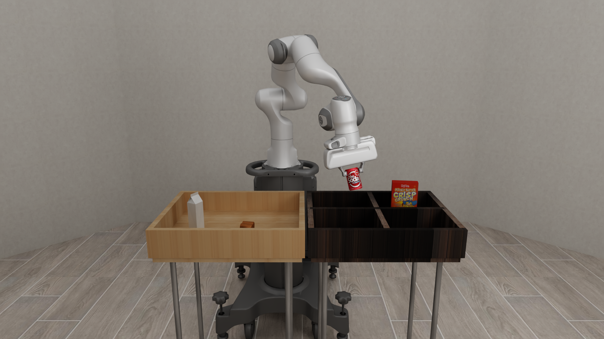
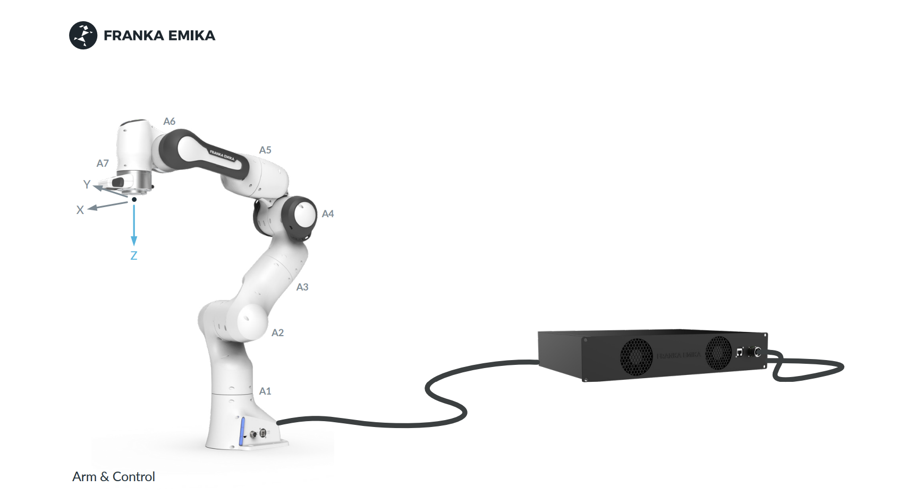

# 第 02 章 · 机械臂动作

上一章，我们给红杯场景里的机械臂发了一条 7 维的增量指令，看到了动作前后的相机画面，也测出了末端实际只移动了一小段距离。这一章从那条指令出发，拆解每个数字控制什么、底层控制器怎样响应指令，以及主流 VLA 模型是如何选择动作表示的。

## 1. 状态和动作有什么区别



想象夹爪正悬在杯子旁边。它现在在哪里、朝哪边、张开了多少，这些是**状态**。接下来要往杯子的方向移一点、转一下手腕，或者合上夹爪，这些是**动作**。

在代码里，`env.reset()` 返回初始观测，观测里有相机画面和机械臂状态。把一条动作交给 `env.step(action)`，仿真器推进一步，我们就能读到新的画面和状态。训练时，我们希望模型学会根据当前观测和任务指令，预测这一步该发什么动作。

## 2. 动作向量的两种常见表示



本项目使用 LIBERO 红杯场景里的末端位姿控制接口，仿真环境里的机械臂原型是 Franka Emika Panda。在看控制指令之前，先理解一个基础概念——**自由度（DoF）**：要用几个能独立变化的数字，才能描述机械臂当前的姿势？

比如，一扇门只需要一个角度就能描述开到了哪里，它有 1 个自由度。Panda 机械臂从底座到手腕有 7 个可以独立转动的关节，需要 7 个关节角来描述整条手臂的姿势，所以它有 7 个自由度。

同样是「把夹爪抬高一点」，可以用两种空间给控制器发指令：

| 表示 | 向量里的数字描述什么 | 例子 |
| --- | --- | --- |
| **关节空间（Joint Space）** | 各个关节的目标值，例如目标角度 | 「第 2 个关节转到 30°，第 4 个关节转到 −90°」 |
| **任务空间（Task Space）** | 末端的位置和朝向目标，或者它们的变化量 | 「夹爪沿 Z 轴抬高 1 cm，保持原来的朝向」 |

在关节空间里，Panda 的七个关节角可以用七个数字来描述，夹爪开合另外记录。原版 ACT 在 ALOHA 的演示上学习的就是双臂关节目标位置。[ACT 论文](https://arxiv.org/html/2304.13705#S4)

### 红杯实验的七个数字

本实验使用**任务空间的增量指令**。机械臂的末端就是装着夹爪的那一端。我们指定末端怎么移动和转动，控制器再计算如何驱动各个关节。

```text
[dx, dy, dz, rx, ry, rz, gripper]
```

| 位置 | 分量 | 含义 |
| ---- | ---- | ---- |
| 1–3 | `dx`、`dy`、`dz` | 沿仿真坐标的 X、Y、Z 轴移动 |
| 4–6 | `rx`、`ry`、`rz` | 改变末端朝向。比如只有 `rz` 非零时，目标是绕 Z 轴转动 |
| 7 | `gripper` | 控制夹爪，`-1` 请求张开，`+1` 请求闭合 |

旋转的三个分量共同组成一个**旋转向量**，用来表达这一步绕哪个轴、转多大角度。相机有自己的视角，所以沿仿真 X 轴移动，在屏幕上可能看起来是斜着走的。实验动作的七维来自 **3 个平移分量 + 3 个旋转分量 + 1 个夹爪指令**，而 Panda 本体的七个自由度来自七个关节角。[robosuite 控制器文档](https://robosuite.ai/docs/modules/controllers.html) · [Panda 夹爪实现](https://github.com/ARISE-Initiative/robosuite/blob/v1.4.0/robosuite/models/grippers/panda_gripper.py)

### 从关节到末端：正运动学（FK）与逆运动学（IK）

既然人写任务往往更关心「夹爪去哪」，而机械臂电机真正执行的是「每个关节转多少度」，两者之间就需要做空间转换：

- **正运动学（Forward Kinematics, FK）**：已知所有关节角度，计算末端在哪里、朝哪边。从底座开始顺着每节连杆的几何长度和关节角度一步步叠加即可，答案唯一且很容易算。仿真器（如 MuJoCo）在每个物理步都会跑一次 FK 来更新机械臂各部件的空间位置。
- **逆运动学（Inverse Kinematics, IK）**：反过来，给定一个任务空间的末端目标位姿，反推各关节应该转到什么角度。这一步往往很棘手，主要有三个原因：
  1. **多解性（同一个末端位置，不止一种摆法）**：就像人的手腕停在桌前同一个位置，手肘可以抬高（elbow-up）也可以放低（elbow-down）。如果模型输出一串末端坐标，而每一步都独立重新求解 IK，关节角可能会在不同解之间剧烈跳变。
  2. **不可达与碰撞**：任务空间里的很多位姿机械臂根本够不到，或者会导致连杆互相碰撞。对于自由度不足 6 的廉价机械臂（例如只有 5 个手臂关节的 SO-100），在 6 维任务空间（3 维位置 + 3 维朝向）里随机挑一个目标位姿，精确可达的概率甚至是 0%。
  3. **奇异点（Singularity）**：当手臂接近完全伸直等特殊姿势时，末端哪怕只想以很小的匀速继续往前伸，某些关节所需的角速度和力矩也会急剧飙升，超过电机上限后控制器就会掉队。

## 3. 增量、绝对目标和输入缩放

假设末端现在的 X 坐标是 `0.30 m`，希望它往 X 正方向走 `0.01 m`。用**增量目标（Delta）** 描述，就是「沿 X 加 `0.01 m`」；用**绝对目标（Absolute）** 描述，就是「去 X 等于 `0.31 m` 的位置」。本项目的位姿控制采用第一种方式。

关节空间同样既可以用绝对目标，也可以用增量。比如「把第 2 个关节转到 30°」和「让第 2 个关节再转 5°」，控制的是同一个关节。

控制器接收的是缩放后的输入约定。以上一章的动作 `[0.25, 0, 0, 0, 0, 0, -1]` 为例，前三个分量的输入范围是 `[-1, 1]`，控制器把这个范围映射到 `[-0.05 m, 0.05 m]` 的目标位移。所以 `dx = 0.25` 对应约 **12.5 mm 的目标增量**。上一章在 Colab 的一次运行中，执行一步后实际测得 X 方向移动约 **1.27 mm**。动作给出的是控制目标，实际位移要从执行后的观测里读取，一步内机械臂只走了目标位移的一部分。[robosuite 1.4 控制器配置](https://github.com/ARISE-Initiative/robosuite/blob/v1.4.0/robosuite/controllers/config/osc_pose.json)

### 为什么发了 12.5 mm，一步只走了 1.27 mm？

很多初学者会以为 `env.step(action)` 会让机械臂直接「瞬移」到目标位置。实际上，无论上层用的是任务空间还是关节空间，模型发出的都只是**期望目标**，真正驱动机械臂运动的是底层的**伺服控制器（常见为 PID 控制器）**：

- 可以把控制器想象成一个 **「弹簧 + 阻尼器」**：当前位置离目标越远，弹簧拉力（P 项）越大，把关节往目标拉；为了防止冲过头来回晃，阻尼器（D 项）会根据运动速度施加反向阻力。
- 因为机械臂自身有惯性、电机的最大输出力矩有限，而且一个控制步长的时间很短，机械臂在这一步里只能往目标追近一小段距离。
- 如果一次给出的目标增量跳变太大，控制器输出会被电机最大力矩截断，甚至来不及刹车而冲过头（overshoot）。这也是为什么控制器会把输入限制在安全范围内，以及连续平滑的动作序列更有利于稳定控制。[机械臂底层控制参考（How robot arms are controlled）](https://x.com/ja_rothschild/article/2100633491432239411)

如果后续训练时对动作做归一化，那是模型侧的数据处理。执行前要先把模型输出还原到环境接受的动作范围，再交给控制器。

## 4. VLA 到底该选哪种动作空间？

回到第 00 章介绍的几类代表性 VLA 模型，你会发现它们选择的动作表示并不一样，这背后其实是对「泛化需求」和「控制难度」的权衡：

- **跨多种机械臂的通用模型（如 OpenVLA）→ 常选「任务空间增量」**：不同机械臂的关节数量、连杆长度各不相同，但它们都有末端的夹爪位姿。用任务空间增量表示动作，更容易把不同机器人的数据统一起来；同时「增量」只关心相对当前位置怎么动，分布更集中，也更容易做归一化。代价是底层必须配好 IK 或末端位姿控制器（例如本项目使用的 `osc_pose`）。
- **针对单款机械臂的模型（如 ACT、$\pi_0$）→ 常选「关节空间」**：如果模型只服务于同一台机械臂，遥操作采集到的演示数据本身就是各关节角度。让模型直接预测目标关节角发给舵机，就能彻底绕开 IK 的多解跳变和奇异点问题。
- **「绝对目标 vs 增量」是另一个独立选择**：同样在关节空间，ACT 预测的是**绝对**目标关节角（论文中对比发现增量在它的设定下效果更差），而 $\pi_0$ 的官方实现则训练模型预测关节**增量**。本项目为了直接配合 LIBERO 的任务空间接口，采用的是**任务空间增量 + 夹爪指令**。

## 5. 一次预测一步，还是预测一小段

一次预测一个动作时，输出是一条长度为 7 的向量，形状可以写成 `(7,)`。如果一次预测接下来的 4 步，输出就是形状为 `(4, 7)` 的**动作块（Action Chunk）**，每一行都是可以交给 `env.step()` 的一条动作。

以抓杯为例，一小段动作可能先向杯口靠近，再合上夹爪。模型可以预测 4 步，执行时也可以只用前几步，然后根据新的相机画面重新预测。**预测几步**和**执行几步后重新观察**是两个独立的选择。

## 6. 实验和下一章

[本章实验](experiment.md)用红杯场景做三个小对照，分别观察平移、旋转和夹爪开合。

到了模仿学习，**模型预测什么，取决于我们把什么当作动作标签**。演示数据可以记录关节目标，也可以记录末端动作。读取演示时，可以直接使用记录的表示，也可以在预处理时转换。红杯项目要学习的是上面这套末端增量和夹爪指令，执行时把预测转换回 `env.step()` 接收的格式。

下一章再看如何从演示轨迹里取出一份观测，配上当时发出的动作，组成一个训练样本。[第 03 章 · 数据集](../03_dataset/README.md)
