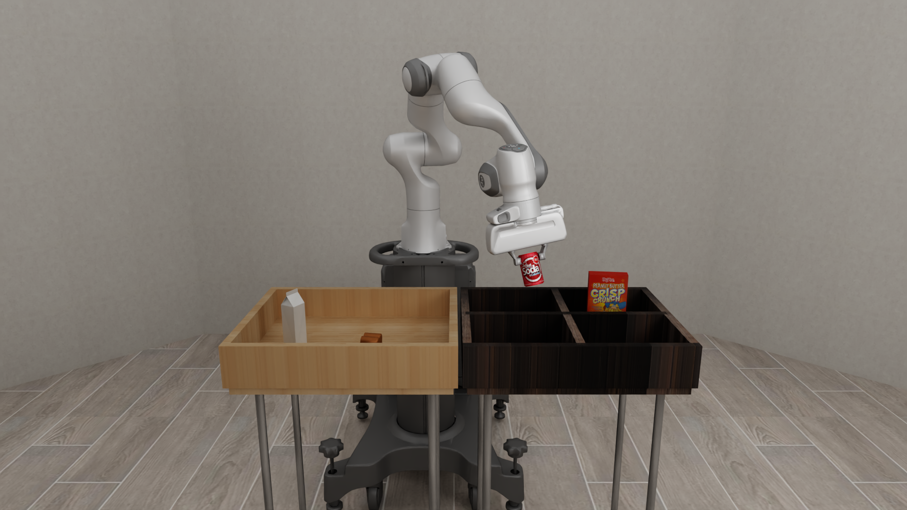
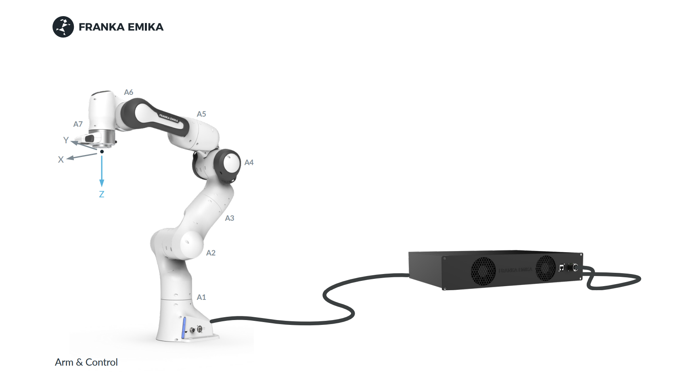

# 第 02 章 · 机械臂动作

上一章，我们给红杯场景里的机械臂发了一条 7 维的增量指令，看到了动作前后的相机画面，也测出了末端实际只移动了一小段距离。这一章从那条指令出发，拆解每个数字控制什么、底层控制器怎样响应指令，以及主流 VLA 模型是如何选择动作表示的。

## 1. 状态和动作有什么区别



想象夹爪正悬在杯子旁边。它现在在哪里、朝哪边、张开了多少，这些是**状态**。接下来要往杯子的方向移一点、转一下手腕，或者合上夹爪，这些是**动作**。

在代码里，`env.reset()` 返回初始观测，观测里有相机画面和机械臂状态。把一条动作交给 `env.step(action)`，仿真器推进一步，我们就能读到新的画面和状态。训练时，我们希望模型学会根据当前观测和任务指令，预测这一步该发什么动作。

## 2. 动作向量的两种常见表示



本项目使用 LIBERO 红杯场景里的末端位姿控制接口，仿真环境里的机械臂原型是 Franka Emika Panda。在看控制指令之前，先理解一个基础概念——**自由度（DoF）**：要用几个能独立变化的数字，才能描述机械臂当前的姿势？

比如，一扇门只需要一个角度就能描述开到了哪里，它有 1 个自由度。Panda 机械臂从底座到手腕有 7 个可以独立转动的关节，需要 7 个关节角来描述整条手臂的姿势，所以它有 7 个自由度。

想让夹爪抬高一点，可以从关节和末端两个角度来描述动作。

| 表示 | 向量里的数字描述什么 | 例子 |
| --- | --- | --- |
| **关节空间（Joint Space）** | 各个关节的目标值，例如目标角度 | 「第 2 个关节转到 30°，第 4 个关节转到 −90°」 |
| **任务空间（Task Space）** | 末端的位置和朝向目标，或者它们的变化量 | 「夹爪沿 Z 轴抬高 1 cm，保持原来的朝向」 |

在关节空间里，Panda 的七个关节角可以用七个数字来描述，夹爪开合另外记录。原版 ACT 在 ALOHA 的演示上学习的就是双臂关节目标位置。[ACT 论文](https://arxiv.org/html/2304.13705#S4)

### 红杯实验的七个数字

第 01 章和本章实验的任务空间组都使用**末端增量指令**。机械臂的末端就是装着夹爪的那一端。我们指定末端怎么移动和转动，控制器再计算如何驱动各个关节。

```text
[dx, dy, dz, rx, ry, rz, gripper]
```

| 位置 | 分量 | 含义 |
| ---- | ---- | ---- |
| 1–3 | `dx`、`dy`、`dz` | 沿仿真坐标的 X、Y、Z 轴移动 |
| 4–6 | `rx`、`ry`、`rz` | 改变末端朝向。比如只有 `rz` 非零时，目标是绕 Z 轴转动 |
| 7 | `gripper` | 控制夹爪，`-1` 请求张开，`+1` 请求闭合 |

旋转的三个分量共同组成一个**旋转向量**，用来表达这一步绕哪个轴、转多大角度。相机有自己的视角，所以沿仿真 X 轴移动，在屏幕上可能看起来是斜着走的。实验动作的七维来自 **3 个平移分量 + 3 个旋转分量 + 1 个夹爪指令**，而 Panda 本体的七个自由度来自七个关节角。[robosuite 控制器文档](https://robosuite.ai/docs/modules/controllers.html) · [Panda 夹爪实现](https://github.com/ARISE-Initiative/robosuite/blob/v1.4.0/robosuite/models/grippers/panda_gripper.py)

### 从关节到末端：正运动学（FK）与逆运动学（IK）

「夹爪在哪」和「每个关节转了多少」是描述机械臂姿势的两个角度。运动学研究的就是它们之间的关系。

- **正运动学（Forward Kinematics, FK）**从关节角度算出末端的位置和朝向。可以从底座沿着各节连杆，依次应用每个关节的转动。在底座和机械臂结构固定的情况下，一组关节角对应一组末端位姿。
- **逆运动学（Inverse Kinematics, IK）**：反过来，给定一个任务空间的末端目标位姿，反推各关节应该转到什么角度。这一步往往很棘手，主要有三个原因：
  1. **多解性（同一个末端位置，不止一种摆法）**：就像人的手腕停在桌前同一个位置，手肘可以抬高（elbow-up）也可以放低（elbow-down）。如果模型输出一串末端坐标，而每一步都独立重新求解 IK，关节角可能会在不同解之间剧烈跳变。
  2. **不可达与碰撞**：有些目标够不到，有些目标虽然够得到，却会让连杆碰到桌子或彼此相撞。比如手臂只有 5 个自由度时，即使末端能到达一个位置，也只能在一定范围内选择朝向。
  3. **奇异点（Singularity）**：在某些姿势下，例如手臂完全伸直，末端能够瞬时移动的方向会受限。接近这类姿势时，要让末端沿受限方向移动，可能需要很大的关节角速度。

IK 是实现末端控制的一种方法。本章用的 `OSC_POSE` 根据末端的位置和朝向误差算出各关节的驱动力矩。日志里的关节角是执行后测到的变化。 [robosuite 1.4 的 OSC 实现](https://github.com/ARISE-Initiative/robosuite/blob/v1.4.0/robosuite/controllers/osc.py)

## 3. 增量、绝对目标和输入缩放

假设末端现在的 X 坐标是 `0.30 m`，希望它往 X 正方向走 `0.01 m`。用**增量目标（Delta）** 描述，就是「沿 X 加 `0.01 m`」；用**绝对目标（Absolute）** 描述，就是「去 X 等于 `0.31 m` 的位置」。本项目的位姿控制采用第一种方式。

关节空间同样既可以用绝对目标，也可以用增量。比如「把第 2 个关节转到 30°」和「让第 2 个关节再转 5°」，控制的是同一个关节。

控制器接收的是缩放后的输入约定。以上一章的动作 `[0.25, 0, 0, 0, 0, 0, -1]` 为例，前三个分量的输入范围是 `[-1, 1]`，控制器把这个范围映射到 `[-0.05 m, 0.05 m]` 的目标位移。所以 `dx = 0.25` 对应约 **12.5 mm 的目标增量**。上一章在 Colab 的一次运行中，执行一步后实际测得 X 方向移动约 **1.27 mm**。动作给出的是控制目标，实际位移要从执行后的观测里读取，一步内机械臂只走了目标位移的一部分。[robosuite 1.4 控制器配置](https://github.com/ARISE-Initiative/robosuite/blob/v1.4.0/robosuite/controllers/config/osc_pose.json)

### 为什么发了 12.5 mm，一步只走了 1.27 mm？

一次 `env.step(action)` 会设定目标，并让仿真器推进一个控制步。可以把控制器里作用在误差上的两项想象成**弹簧和阻尼器**。离目标越远，弹簧拉得越用力（比例项 P），阻尼则根据当前速度减缓运动（微分项 D）。

机械臂有惯性，控制器只有一个控制步的时间来追踪目标。实际走多远还会受当前姿势和运动速度影响，所以这次测到了约 1.27 mm。连续发相同增量时，每一步都从当时测到的位置或关节角重新设目标。 [robosuite 1.4 的 OSC 实现](https://github.com/ARISE-Initiative/robosuite/blob/v1.4.0/robosuite/controllers/osc.py) · [延伸阅读：How robot arms are controlled](https://x.com/ja_rothschild/article/2100633491432239411)

如果后续训练时对动作做归一化，那是模型侧的数据处理。执行前要先把模型输出还原到环境接受的动作范围，再交给控制器。

## 4. VLA 到底该选哪种动作空间？

动作格式要配合**演示数据和机器人控制接口**。选好关节空间或任务空间后，还可以独立决定用绝对目标还是增量。

- **OpenVLA** 预训练选用了单臂末端控制的数据。统一用末端动作，可以把不同关节结构的机械臂放进同一个训练框架。执行时，各平台还要约定好坐标方向、单位和控制接口。 [OpenVLA 论文](https://arxiv.org/html/2406.09246)
- **原版 ACT** 用 ALOHA 的遥操作数据学习双臂的绝对关节目标。控制器可以直接跟踪这些关节目标。 [ACT 论文](https://arxiv.org/html/2304.13705#S4)
- **$\pi_0$** 用多种机器人配置的演示预训练。以官方 OpenPI 为例，ALOHA 的配置可以把关节目标转成关节增量来训练，LIBERO 的配置则可以沿用数据里已有的末端增量。 [π₀ 论文](https://arxiv.org/html/2410.24164) · [OpenPI 数据配置](https://github.com/Physical-Intelligence/openpi/blob/main/src/openpi/training/config.py)

## 5. 一次预测一步，还是预测一小段

以本项目训练时使用的 **7 维末端动作**为例，一次预测一个动作时，输出形状是 `(7,)`。如果一次预测接下来的 4 步，输出就是形状为 `(4, 7)` 的**动作块（Action Chunk）**。每一行对应一个控制步，执行前要转换到环境需要的格式。

以抓杯为例，一小段动作可能先向杯口靠近，再合上夹爪。模型可以预测 4 步，执行时也可以只用前几步，然后根据新的相机画面重新预测。**预测几步**和**执行几步后重新观察**是两个独立的选择。

## 6. 实验和下一章

[本章实验](experiment.md)在同一个红杯场景里直接对照**关节空间（`JOINT_POSITION`，7 个关节增量 + 1 个夹爪指令，共 8 维）**和**任务空间（`OSC_POSE`，6 个末端位姿增量 + 1 个夹爪指令，共 7 维）**。两组使用同一份初始仿真快照。一组只给单个关节发转动指令，观察末端的 XYZ 位移。另一组给末端发沿 Z 轴移动的指令，观察哪些关节跟着动。

到了模仿学习，**模型预测什么，取决于我们把什么当作动作标签**。演示数据可以记录关节目标，也可以记录末端动作。读取演示时，可以直接使用记录的表示，也可以在预处理时转换。红杯项目要学习的是上面这套末端增量和夹爪指令，执行时把预测转换回 `env.step()` 接收的格式。

下一章再看如何从演示轨迹里取出一份观测，配上当时发出的动作，组成一个训练样本。[第 03 章 · 数据集](../03_dataset/数据集与样本构造.md)
